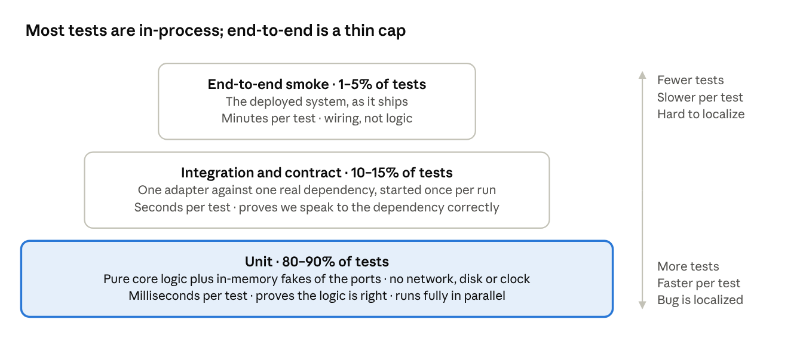
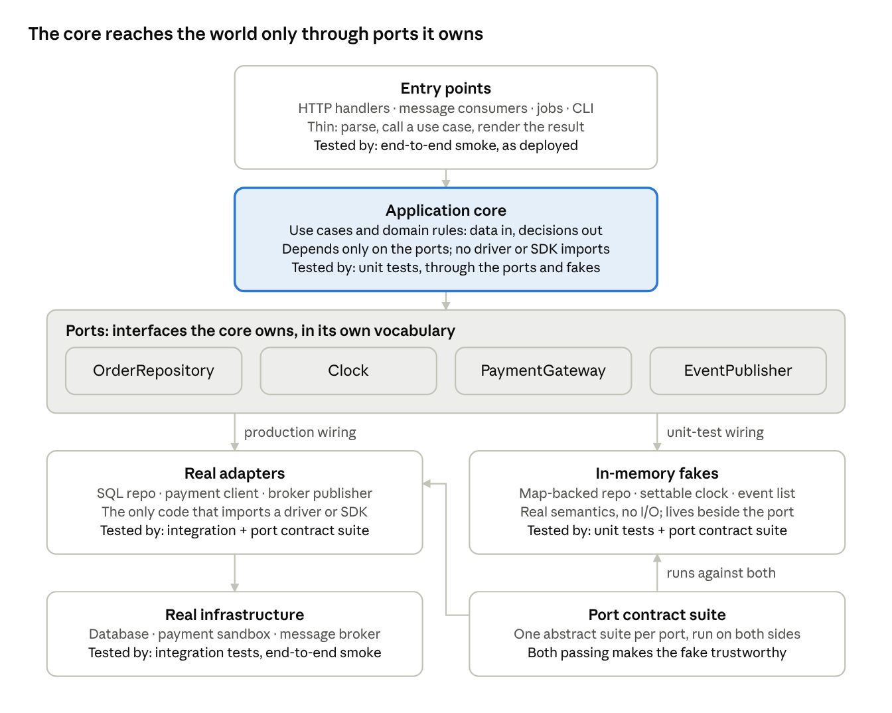

# Layered Test Strategy: Designing Boundaries for Fast, Reliable Test Suites

Oct 31, 2026

## The thesis: suite speed is an architecture property

A slow, flaky test suite is almost always a design problem wearing a testing costume. If a business rule can only be reached through a running database, a message broker and three HTTP services, then every test of that rule must boot those things. No test runner, parallelizer or caching layer fixes that; only the boundaries in the code can.

The goal is a suite where:

- Almost all behavior is verified in-process, in milliseconds, with no network, disk or clock.
- Each external dependency is verified once, at its adapter, against a real instance of that dependency.
- A small, fixed number of end-to-end tests prove the assembled system is wired and alive, not that the logic is right.

"Launching 19 copies of the world" happens when the application has no seams. This document is about where to cut the seams so that every test can sit at the lowest layer that proves the thing you care about. The test strategy and the architecture are the same decision viewed from two sides.

## The cost model

Each layer up costs roughly an order of magnitude more per test, on every dimension that matters.

| Dimension | Unit (in-process) | Integration (one real dependency) | End-to-end (whole system) |
| --- | --- | --- | --- |
| Wall time per test | 0.1–10 ms | 10 ms–2 s | 5 s–5 min |
| Setup required | None | One container or sandbox | A full deployed environment |
| Parallelism | Free | Needs an isolation strategy | Often serialized |
| Flakiness sources | Essentially none | Network, timing, shared state | All of the above, multiplied |
| What a failure tells you | Which function, which input | Which adapter, which query | Something, somewhere, is wrong |
| Cost per behavior change | Local | Moderate | High; brittle to UI and API shape |

Two consequences follow. A behavior that can be proven at a lower layer should never be proven at a higher one, because the higher test adds cost without adding confidence. And the suite should be a pyramid by count and by run time: thousands of unit tests in seconds, hundreds of integration tests in minutes, tens of end-to-end tests.

Target shape by count: roughly 80–90% unit, 10–15% integration and contract, 1–5% end-to-end. Treat the ratio as a diagnostic. When it inverts, the design is making you pay for it, and the fix is in the code rather than the CI configuration.

Reading it: every step up the stack trades count and speed for breadth. The base layer carries the logic; the cap only proves the pieces are wired.

## The four layers

Each layer answers one question and is allowed to touch one set of things. A test that needs more than its layer allows either belongs one layer up, or is telling you the design is missing a seam.

| Layer | Question it answers | May touch | May not touch | Share of suite |
| --- | --- | --- | --- | --- |
| Unit | Is the logic right? | Pure code; in-memory fakes of ports | Network, disk, database, real clock, other processes | 80–90% |
| Integration (adapter) | Does our adapter speak correctly to this one real dependency? | One real dependency and the adapter under test | Other dependencies; the rest of the application | 10–15% |
| Contract | Do the two sides of a seam agree on the shape and meaning of messages? | A declared or recorded interaction; the fake and the real adapter, separately | Both sides running together | One suite per seam |
| End-to-end smoke | Is the assembled system wired, configured and alive? | Everything, deployed as it ships | Edge cases and business-rule variants | 1–5%, hard cap |

Two vocabulary points matter here. "Unit" means in-process and isolated from infrastructure, not "one class": a unit test may drive a whole use case through a dozen collaborating objects, and what makes it a unit test is that it needs nothing outside the process. "Integration" means integration with infrastructure, not integration between modules; modules integrate with each other in unit tests.

## Principle 1: separate the decision from the effect

Most code mixes two jobs: deciding what should happen, and making it happen. Decisions are pure logic: validation, calculation, state transitions, choosing which command to issue. Effects are I/O: reads, writes, sends, calls. Decisions can be unit tested exhaustively; effects can only be tested against the real thing.

The design move is to push every decision into code that takes plain data in and returns plain data out, and to push every effect into a thin outer shell that executes what the core decided. One operation then has three steps:

1. Shell: load the inputs the decision needs (a record, the current time, the request).
2. Core: compute the result, as new state, events to emit, commands to issue, or an error.
3. Shell: persist, publish, respond.

Concrete patterns:

- Return commands instead of performing them. Rather than `process_order()` calling the payment gateway, have it return `ChargeCard(amount, token)` and let the shell execute it. The test asserts on the returned command, not on a mock's call log.
- Make state transitions explicit. A function of the form `apply(state, event) -> new_state` is trivially testable; a method that mutates in place and also writes to the database is not.
- Keep the shell boring. It should have no branches worth testing. An `if` in the shell is logic that wants to move into the core.
- Let the core speak in domain errors. Return `InsufficientFunds`, not a database exception; the shell maps domain results to HTTP codes, retries, or messages.

What this buys: the core, which is where the bugs live, is tested with thousands of cases in a second. The shell is covered by a handful of integration and smoke tests, because there is almost nothing in it to get wrong.

## Principle 2: every external dependency behind a port you own

A port is an interface, defined by the application in the application's vocabulary, for something outside the process: a repository, a clock, a mailer, a payment gateway, a message publisher, a feature-flag source. An adapter implements a port against one specific technology. The core depends only on ports; adapters are the only code that imports a driver, a client or an SDK.

Reading it: the composition root decides which implementation sits behind each port. Unit tests wire the fakes, integration tests exercise one real adapter, and the contract suite keeps the two sides honest.

Rules that make this work for testing:

- Define the port in the application's terms, not the dependency's. `OrderRepository.open_orders_for(customer)`, not `Database.query(sql)`. A port that leaks the technology (SQL strings, HTTP status codes, SDK types) makes every caller untestable without that technology.
- Keep ports narrow. A port with forty methods is a port nobody can fake correctly. Several small ports, each serving one family of use cases, are easier to fake and easier to replace.
- Two implementations per port, by default: the real adapter and an in-memory fake. A third implementation per test file is the mocking anti-pattern covered under Principle 3.
- Ports are the only path to the outside. Enforce this with a dependency rule in the build or linter (no infrastructure imports outside the adapters package), because it erodes otherwise.
- Translate at the edge. The adapter converts the dependency's errors, types and pagination into the port's domain-level equivalents, so nothing above it knows which vendor is behind the port.

Where to put the seam: at the process boundary, not at every class boundary. Abstracting internal collaborators produces interface noise and tests that verify wiring instead of behavior. The seam belongs exactly where a test would otherwise need something that is not in memory.

## Principle 3: a few high-fidelity fakes, not many mocks

A mock is a per-test stand-in that records calls and returns canned answers. A fake is a working implementation of the port with a simple backing store: an in-memory repository, a clock you can set, a message bus that collects published messages in a list. Fakes are what let the unit layer carry 80–90% of the suite without lying.

Why fakes win:

- Tests say what they mean. A test against a fake repository arranges state (`repo.add(order)`) and asserts on outcomes (`repo.get(id).status == Shipped`). A mock-based test asserts on interactions (`save` was called once with these arguments), which couples the test to the implementation and breaks on every refactor.
- One fake serves hundreds of tests. Mocks are rewritten per test; a fake is written once, kept beside the port, and reused across the codebase and in local development.
- Fakes catch real bugs. A fake repository that enforces a uniqueness constraint fails a test that a mock would pass.
- Fakes are the unit of trust. Every fake is verified against the real adapter by the same port contract suite (see Contract tests). Once that holds, a unit test against the fake is nearly as trustworthy as one against the real dependency, at a thousandth of the cost.

Building good fakes:

- Keep them next to the port, in production-visible code rather than a test folder, so port, adapter, fake and contract suite version together.
- Implement real semantics: ordering, uniqueness, not-found behavior, and the error cases the real dependency produces.
- Offer inspection hooks (`published_messages`, `sent_emails`, `advance_time(by)`) so tests observe outcomes without reaching inside.
- Keep them simple. A fake that needs its own tests beyond the contract suite has grown too clever.

When a mock is still the right tool: verifying that a specific side effect was requested at a specific point (an audit entry, a metric), or stubbing a third-party SDK you cannot wrap cleanly. Keep those at the edge and few.

## Principle 4: one composition root, so a test can assemble a smaller application

The composition root is the single place where the application is wired: adapters are constructed, injected into use cases, and entry points (HTTP handlers, consumers, CLI commands) are bound. Nothing else constructs its own dependencies.

This is what makes the layers cheap. If construction is centralized, a test calls the same assembly function with a different set of ports (all fakes, or one real adapter and the rest fakes) and gets a fully functioning application in memory. If construction is scattered (`new DatabaseConnection()` inside a service, a global singleton for the HTTP client), the only way to get a working application is to boot the real one, and every test becomes an end-to-end test.

A practical layout, three functions:

- `build_app(ports) -> App`: pure assembly; takes already-constructed port implementations and returns the use cases and entry points.
- `build_production_ports(config) -> Ports`: constructs the real adapters from configuration.
- `build_fake_ports() -> Ports`: constructs the fakes, exposing the handles tests need.

Which gives each layer its own cheap entry:

| Layer | How the test assembles the system |
| --- | --- |
| Unit test of a use case | `build_app(build_fake_ports())`; call the use case; assert on the fakes |
| Integration test of one adapter | Construct that adapter alone against a real dependency; no `build_app` |
| In-process test of an HTTP or messaging boundary | `build_app(fakes)` behind an in-process handler; no sockets |
| End-to-end smoke | `build_app(build_production_ports(config))`, the exact production code path |

The rule to protect: no hidden construction. Static access to infrastructure (global database handles, ambient HTTP clients, service locators, framework-managed singletons the code reaches for) is the single most common reason a codebase cannot be tested below the end-to-end layer.

## Principle 5: make time, randomness, identity, concurrency and config explicit

These are the usual reasons a test that should be a unit test ends up needing sleeps, retries or a real environment. The fix is the same each time: the thing varies at runtime, so it enters the core as a value or through a port, never by the core reaching out for it.

| Hidden dependency | Symptom in the tests | Design fix |
| --- | --- | --- |
| Wall clock | `sleep()` in tests; failures at midnight or month-end; anything involving expiry or scheduling needs a real wait | A `Clock` port, or pass `now` into the core as a parameter; the fake lets tests set and advance time |
| Randomness and ID generation | Non-deterministic assertions; snapshots that never match | An `IdGenerator` or `Random` port; or generate in the shell and pass values in |
| Ambient identity and request context | Tests must set up auth, sessions or thread-locals before calling logic | Pass the principal and context as explicit arguments to the core |
| Concurrency and background work | Tests poll for completion; flaky ordering; thread pools inside unit tests | A `Scheduler` or `Executor` port with a synchronous fake; separate "decide to enqueue" from "run the job" |
| Environment and configuration | Tests read environment variables, config files or a flag service | Parse config once at the composition root into a plain value and pass it down; flags enter as a port |
| Filesystem | Temp directories, cleanup fixtures, path-separator bugs | A `Storage` or `FileStore` port with an in-memory fake; the core works on streams or bytes |

A useful test of the design: can the entire core be exercised in a single thread, with no sleeps, in a process that has no network interfaces and a frozen clock? If not, one of these is leaking in.

## Principle 6: draw module boundaries so most behavior lives inside one

Test cost rises steeply with the number of boundaries a behavior crosses. A feature whose logic is spread across five services needs five services running to test it end-to-end, and a change to any one of them surfaces failures in the other four suites.

Design for locality:

- Organize by capability, not by technical layer. A `billing` module that owns its rules, its persistence adapter and its API can be tested alone. A `models` package shared by everything can be tested in isolation by nothing.
- A behavior should be fully specifiable within its module. If a feature's acceptance criteria cannot be written without naming three other modules, the boundaries are in the wrong place.
- Cross-boundary interaction should be thin, asynchronous where the domain allows, and defined by a contract (a message schema, an API spec) that both sides test against independently.
- Internal modules talk through in-process interfaces, not network calls. Splitting into separately deployed services should be driven by operational needs (independent scaling, ownership, release cadence), never by code organization. Every network boundary you introduce is a boundary tests must cross.
- Share data by contract, not by database. Two modules reading the same tables cannot be tested, changed or deployed independently, whatever the repository layout says.

Where this meets service decomposition: a monolith with clean internal module boundaries is almost always cheaper to test than a distributed system with the same boundaries, because its integration is a function call. If the system is already distributed, the contract layer is what prevents the "run all 19 services" test from becoming the default.

## Integration tests: test the adapter, not the world

An integration test verifies one adapter against one real instance of its dependency. It does not boot the application, does not go through HTTP, and involves no other dependency. If you are starting more than one piece of infrastructure to run an integration test, it is not an integration test.

Shape of a good one:

1. Construct the adapter directly, pointed at a real database, broker or vendor sandbox started once for the whole run.
2. Exercise the port's methods: save then load, publish then consume, call then inspect.
3. Assert on behavior observable through the port, and where necessary on the dependency's own state (the row exists, the message is on the topic).
4. Run the port's full contract suite against this adapter.

What it should cover: query correctness, schema mapping, transaction and isolation semantics, serialization, error translation (a unique-constraint violation becomes `DuplicateOrder`), pagination, timeouts and retries, connection handling.

What it should not cover: business rules. An integration test that asserts a discount was computed correctly means the discount logic lives in the adapter or the query, and should move to the core.

Keeping the layer fast:

- Start infrastructure once per run, or once per parallel worker, never per test or per class. Container-per-test is the single most common cause of a 20-minute integration suite.
- Isolate tests by transaction rollback, a per-worker schema or namespace, or unique key prefixes. Do not drop and recreate the database between tests.
- Use the real dependency, not an "embedded" or "compatible" look-alike, unless the look-alike is proven behaviorally equivalent for your usage. Dialect and consistency-model differences are exactly the bugs this layer exists to catch.
- Keep it hermetic: no shared staging databases, no third-party production APIs. Use vendor sandboxes or recorded interactions, and refresh recordings on a schedule.
- Run migrations once at startup and reuse the schema; apply only data resets between tests.

A well-shaped integration layer is a few hundred tests that run in a few minutes, each one a precise statement about how the application talks to one external system.

## Contract tests: verify seams without running both sides together

Two kinds of seam need a contract, and in both cases the contract replaces a test that would otherwise need several systems running at once.

**Port contracts: fake versus real adapter.** Write one abstract test suite per port that states the port's semantics: saving then loading returns an equal object; loading a missing id returns not-found; publishing preserves order; a duplicate key raises `Duplicate`. Run that suite twice, once against the fake (unit layer, milliseconds) and once against the real adapter (integration layer). When both pass, the fake is trustworthy, and every unit test built on it inherits that trust. When the real dependency changes behavior, the contract fails on the real side, you update the fake to match, and the unit suite immediately shows which business logic that change affects.

**Service contracts: consumer versus provider.** When two separately deployed components communicate, each side tests against a shared description of the interaction instead of against the other side running:

- The consumer's tests run against a stub generated from the contract, and record exactly which fields and behaviors the consumer relies on.
- The provider's tests replay those recorded expectations against the real provider, in isolation, with its own dependencies faked.
- Compatibility is checked at build time by comparing published contract versions, not by deploying both and clicking through.

This turns "spin up both services and hope" into two independent in-process suites plus a schema comparison. Consumer-driven contracts also tell the provider which fields anyone actually uses, so it can change the rest freely.

What belongs in a contract: request and response shape, required and optional fields, error cases, ordering and idempotency guarantees, versioning rules. What does not: business workflows. Those belong in the owning module's unit tests, where they can be exercised with every variant in milliseconds.

## End-to-end smoke tests: small, fixed, and about wiring

The end-to-end layer answers one question: is the system assembled, configured and deployed correctly? It does not verify business rules, edge cases or input validation. Everything that can be proven below this layer already has been, so an end-to-end test that fails should mean a wiring, configuration or environment problem, almost never a logic bug.

An end-to-end test earns its place only when all three hold:

- It crosses a boundary no lower test exercises as deployed: real network, real configuration, real authentication, real infrastructure wiring.
- It follows a path that, if broken, makes the product unusable: sign in, the primary transaction, the main read path, a background job completing.
- Its failure would not be caught by any integration or contract test.

Budget and shape:

- A fixed cap agreed up front: typically 10 to 30 tests for a product, a handful per deployable. Adding one means removing or explicitly justifying one.
- Happy path only, one representative variant per flow. The variants live in unit tests.
- Runs post-deploy against a staging or ephemeral production-like environment, not inside the commit-gating loop.
- Total wall time in single-digit minutes.
- Uses the production composition root and production configuration shape, so it tests what actually ships.

Stopping the growth: every proposed end-to-end test must answer "which lower-layer test would have caught this, and why can't we write that instead?" The honest answer usually reveals a missing seam, and the right fix is to add the seam and the lower test. End-to-end suites grow when teams use them as a substitute for design, and they shrink when design catches up.

## Where does this test belong?

Work from the bottom up and place the test at the lowest layer that can prove the thing you care about.

1. Can the behavior be stated as "given these inputs and this state, this is the output, new state or set of commands"? Unit test against the core, with fakes for any ports. This is the answer for nearly every business rule.
2. Is the thing you care about how the application talks to one specific external system? Integration test on that adapter alone, plus the port's contract suite.
3. Is the thing you care about whether two independently deployed components agree? Contract test on each side.
4. Is the thing you care about whether the deployed assembly works at all? End-to-end smoke, if within budget.

Smells that a test is at the wrong layer, what each one means, and the fix:

| Smell | Diagnosis | Fix |
| --- | --- | --- |
| A "unit" test needs a database or the network | Logic and I/O are tangled | Split into core and shell; introduce a port |
| Many tests set up the same large object graph | No composition root, or ports too wide | Centralize assembly; narrow the ports |
| A test asserts that a mock was called with specific arguments | Testing implementation, not behavior | Replace with a fake and assert on state or outcome |
| A test sleeps or polls | Hidden clock or asynchronous dependency | Clock or Scheduler port with a synchronous fake |
| An integration test asserts a business outcome | Rules live in the adapter or the query | Move the rule to the core; the adapter test checks mapping only |
| An end-to-end test has many variants of one flow | The variants belong lower | Keep one path end-to-end; move variants to unit |
| Changing one module breaks tests in another | Boundaries are wrong or leaky | Re-slice by capability; add a contract at the seam |
| A test fails intermittently | Shared state, timing, or a real external call | Isolate; replace the external with a sandbox or fake |
| A test needs a specific environment variable or config file | Config read inside the core | Parse at the composition root; pass as a value |
| Test setup is longer than the test | Too many collaborators wired by hand | Builders with defaults; assemble through the composition root |

## Suite mechanics

Design gets each test to the right layer; mechanics make each layer run as fast as it can. Neither substitutes for the other.

**Isolation and ordering.** Every test must pass alone, in any order, and in parallel with any other test. Enforce this by randomizing order and running in parallel in CI, and treat an order-dependent failure as a bug in the test. No shared mutable state between tests: no static caches, no shared fixtures that are mutated, no shared rows.

**Parallelism per layer.**

- Unit: parallel across all cores by default; there are no shared resources to contend for.
- Integration: parallel per worker, with per-worker isolation (schema, database, topic prefix) and infrastructure started once per worker.
- End-to-end: parallel only where the environment supports isolated tenants; otherwise accept serialization and keep the count small.

**Test data.** Build data with small builders or factories that default every field and let the test override only what matters. A test that sets thirty fields to exercise one is unreadable and brittle. Never share a seeded database across tests; each test creates what it needs through the same ports production uses.

**Tiers in the pipeline.**

| Tier | When it runs | Contents | Target |
| --- | --- | --- | --- |
| Fast loop | Every commit, pre-merge | Unit + contract | Under 5 minutes wall; the loop developers live in |
| Integration | Pre-merge or merge queue | Adapter tests, parallelized | Under 10–15 minutes wall |
| Smoke | Post-deploy to staging or an ephemeral environment | End-to-end | Single-digit minutes |
| Scheduled | Nightly or weekly, non-blocking | Performance, soak, broad compatibility matrices | Not on the critical path |
| Local | Continuously, on save | Unit; plus integration for the one adapter being touched | Nothing in the fast loop needs more than one container |

**Flakiness policy.** A flaky test is quarantined within one day and either fixed or deleted within a week. Automatic retries hide the design problem that caused the flake and teach people to ignore red. Track flake rate per layer: flakiness in unit tests indicates hidden dependencies; in integration, shared infrastructure; in end-to-end, it is expected, which is why there are so few of them.

**Selective execution.** With clean module boundaries, a change can be mapped to the modules it touches, and only those modules' unit and integration tests need to run pre-merge. This is only safe when the dependency rule is enforced; a codebase where anything can import anything must always run everything.

## Migrating an existing system incrementally

No rewrite is required. Introduce seams where the pain is, and let the pyramid reshape itself over a few quarters.

1. Measure the current shape. Count tests and total time by layer. Find the slowest 10% and the flakiest 10% of tests; they are the first candidates, because they are where the missing seams hurt most.
2. Establish the composition root. Even if it only wraps the existing construction, having one place to swap implementations unlocks every later step. This is usually about a week of work and is the highest-leverage move available.
3. Pick one painful end-to-end or integration test and ask what logic it is actually protecting. Extract that logic into a pure function or core module, write unit tests for it, then delete the expensive test or reduce it to a wiring check.
4. Introduce a port where the code touches infrastructure directly, starting with the dependency most tests need (usually the database). Write the fake and the port contract suite at the same time; the contract suite is what lets you trust the fake.
5. Move tests down as seams appear. Each time a port exists, the tests that only needed that dependency to reach some logic can become unit tests against the fake.
6. Add a dependency rule. Once the pattern exists, stop new code from reaching around it: a lint or architecture test that forbids infrastructure imports outside adapters prevents regression.
7. Cap the end-to-end suite. Freeze the count; convert, do not add.

Techniques that help along the way:

- Wrap a third-party library behind a port before changing anything that uses it.
- Use characterization tests (record what the code does today) to protect logic you are extracting before you fully understand it. Delete them once real unit tests exist.
- Extract-and-override: temporarily make a dependency overridable in a subclass or by parameter, as a stepping stone to a proper port. Remove the stepping stone once the port is in place.
- Strangle, do not replace: route new behavior through the new structure while old behavior stays where it is, and migrate old paths when they next need to change.

Expect the curve to be slow at first. The first seams take effort and pay back modestly. Once the composition root and the two or three most-used ports exist, each further step is cheap, and the test count migrates downward quickly.

## Metrics and governance

The shape of the suite is an architecture concern, so it is measured and reviewed with architecture rather than left to whoever is adding a test under deadline.

Measure continuously:

- Count and total duration per layer. The pyramid should hold on both.
- Wall time of the pre-merge suite, p50 and p95. A steadily rising trend is design debt showing up as CI time.
- Flake rate per layer and per test.
- End-to-end count against its cap.
- Time-to-diagnose: when a test fails, how long until someone knows which code is wrong. End-to-end failures that take hours to localize are the signal to push coverage down.

Budgets to agree and enforce (illustrative; tune to the system):

| Metric | Budget |
| --- | --- |
| Unit layer, total | Under 1 minute, fully parallel, no infrastructure |
| Pre-merge suite (unit + contract), wall time | Under 5 minutes |
| Integration layer, wall time | Under 15 minutes, parallelized |
| End-to-end count per product | Hard cap, for example 30 |
| End-to-end suite, wall time | Under 10 minutes |
| Flaky tests in quarantine | None older than 7 days |
| Share of tests at the unit layer | Above 80% by count |

Review questions for any change that adds a test:

- Is this at the lowest layer that proves the behavior?
- If it needs infrastructure, is it testing the adapter, or is business logic hiding in it?
- If it is end-to-end, which lower-layer test would have caught this, and why can't we write that instead?
- Does it add a new fake or mock? Could an existing fake serve?
- Does it read the clock, the environment, or a global? Why?

Escalation: when a budget is breached for more than one release cycle, treat it as an architecture ticket, not a CI ticket. The fix will be a seam, a port, or a boundary, and it should be scheduled as design work.

## Anti-patterns and failure modes

Each of these is a way the suite drifts back toward launching the world. Most have a design cause and a design fix.

| Anti-pattern | What it looks like | Cause | Fix |
| --- | --- | --- | --- |
| Inverted pyramid | Most coverage end-to-end "because that tests the real thing"; hour-long suites; nobody trusts red | No seams | Everything in this document |
| Container-per-test | A database or broker started for each test or class | Convenience fixtures | Start once per run or worker; isolate by schema or transaction |
| Mock everything | Every collaborator mocked; tests pass while the system is broken; every refactor breaks fifty tests | Mocking framework as default tool | Fakes at the ports; real objects inside |
| Shared staging as a dependency | Integration tests hit an environment others are mutating | No hermetic infrastructure | Infrastructure per run, sandboxes for vendors |
| Testing through the UI by default | Business rules verified by driving a browser | Rules reachable only from the UI | UI tests check wiring; rules move to the core |
| Leaky ports | The interface returns SDK types, SQL or HTTP objects | Port shaped after the vendor | Translate at the adapter; port in domain terms |
| God fixture | One enormous setup every test depends on; nobody dares change it | No builders; shared seed data | Builders with defaults; each test arranges only what it asserts |
| Retry until green | Automatic retries on flaky tests | Avoiding the root cause | Quarantine and fix; retries only for known-external causes with a ticket |
| Distributed monolith | Services split by code organization, so every feature crosses the network | Decomposition for its own sake | Consolidate where possible; contracts where not |
| Coverage as the goal | Percent coverage drives tests at whatever layer is easiest | Wrong metric | Measure shape and speed alongside coverage |
| Test-only code paths | `if testing:` branches in production code | Dependencies not injectable | Composition root and ports; delete the branches |
| Embedded look-alikes | An in-memory "compatible" database standing in for the real one in integration tests | Speed over fidelity | Real dependency at the integration layer; fakes at the unit layer |

## One-page checklist

If every box is ticked, the suite will be fast; if the suite is slow, one of these is unticked.

**Design**

- [ ] Business logic is pure, in-process code that takes data in and returns data or commands out.
- [ ] Every external dependency sits behind a port defined in the application's vocabulary.
- [ ] Each port has exactly one real adapter and one in-memory fake, kept together.
- [ ] A port contract suite runs against both the fake and the real adapter.
- [ ] One composition root assembles the application; there is no hidden construction or static infrastructure access.
- [ ] Time, randomness, identity, concurrency and configuration enter as values or ports.
- [ ] Modules are sliced by capability; a feature's acceptance criteria fit within one module.
- [ ] A dependency rule forbids infrastructure imports outside adapters.

**Tests**

- [ ] Unit tests need nothing outside the process and run in parallel in under a minute.
- [ ] Integration tests exercise one adapter against one real dependency, started once per run.
- [ ] Contract tests cover every cross-service seam, and neither side needs the other running.
- [ ] End-to-end tests are capped, happy-path, post-deploy, and about wiring.
- [ ] Every test passes alone, in any order, in parallel.
- [ ] Flaky tests are quarantined within a day and resolved within a week.

**Governance**

- [ ] Suite shape (count and time per layer) is tracked and reviewed as an architecture metric.
- [ ] Adding an end-to-end test requires naming the lower-layer test that could not be written instead.
- [ ] A breached budget that persists for a release cycle becomes design work, not CI work.
